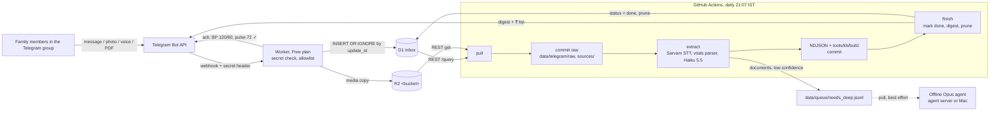

# 005 — Ingest-only Worker (Free plan) + daily batch

Date: 2026-10-25 · Status: **ACCEPTED** (decisions by the user, 2026-10-25) · Supersedes: the real-time bot parts of 001 (inline confirm buttons, immediate alerts; the channel choice stands) and ADR 004's "Telegram ↔ git sync" section (the 3-hourly D1 export). · Related: 003 (media in git), 004 (data model, unchanged), [cost and infra research](../research/cost-and-infra-2026-10.md).

## Context
The app was built for real time: a queue consumer doing STT and extraction per message, confirm buttons in the family's language, immediate Tier 1/2 alerts, an outbox, a reminder cron and a dead-letter path. That needs Workers Paid ($5/mo, 62–94% of the bill) because of the 10 ms CPU limit, and it is the most complex part of the repo.

The user decided on 2026-10-25 that real-time processing and alerts are **not needed**: in an emergency the family uses the phone. What remains is durable capture, a typo check while the sender still has the device in front of them, and a daily record.

## Decision
| Piece | Choice |
|---|---|
| Ingest | One Cloudflare Worker on the **Workers Free plan**, the only always-on part. Verifies `X-Telegram-Bot-Api-Secret-Token`; allowlist in D1 (`chats`, `persons`); `INSERT OR IGNORE` of the raw update into D1 `inbox` (key `update_id`); copies media to R2 at ingest (durability over file_id-only); replies with a short ack. |
| Ack | Deterministic, no LLM (`app/src/vitals.ts`): fixed vitals formats ("120/80 72", "BP 120/80 pulse 72", "बीपी १२०/८०", "wajan 62", "spo2 96", "sugar 110 khali pet") are echoed as "BP 120/80, pulse 72 ✓"; implausible values get "?" (a typo check, not a safety judgement). Anything else gets "✓ मिल गया" / "📷 फ़ोटो मिल गई ✓". Edits are echoed as "सुधार: …". |
| Not in the Worker | No LLM calls, no queues, no cron, no alerts, no extreme-value safety replies (user's choice: none). |
| Daily batch | GitHub Actions `daily-batch.yml`, 15:37 UTC (21:07 IST) + `workflow_dispatch`. **pull** (D1 REST + R2 REST) → commit **raw** to `data/telegram/raw/` and media to `sources/<person>/media/telegram/` → **extract** (Sarvam STT for voice; vitals-only texts from the deterministic parse, so stored values equal the echoed ones; everything else Haiku 5.5 with the existing schema and `parseExtraction`) → `data/telegram/YYYY-MM.ndjson` with provenance → `tools/kb/build` → commit → **finish** (mark inbox rows done, send the digest, prune). |
| Model | `claude-haiku-5-5` for text, transcripts, photos and PDFs, **via the `claude-cli` LLM adapter** (amendment below; was the Messages API). Subscription vs API key is an env choice. |
| Digest | To the family group (`chats.label = 'family'`): what was recorded (fixed templates in the family's language, never LLM text), documents kept for a deep read, and a ❓ list of unclear items (unreadable photo, implausible value, low confidence, failed message, file too big) to answer by replying. Red-flag rules (`src/rules/engine.ts`, unchanged thresholds) appear only as annotations marked **"unverified; doctor sign-off pending"**. A day without a digest is itself the alarm (heartbeat). |
| Deep reads | Documents, prescriptions, reports, medicine photos, low-confidence (<0.8) and failed items are appended to `data/queue/needs_deep.jsonl` for an offline Opus agent (agent server or the Mac, pull-based, best effort). Format and runbook below; the runner is not built. |
| Ops | `deploy-worker.yml`: tests + typecheck, then `wrangler d1 migrations apply` + `wrangler deploy` on a push to `app/`; Worker secrets pushed from GitHub secrets. Optional healthchecks.io-style ping. Git is the source of truth; D1 rows are pruned 14 days (`INBOX_RETENTION_DAYS`) after they are committed. |



## Amendment 2026-10-25 (user): no Anthropic API key; Sarvam deferred
The auth mode below (CLI OAuth token vs API key) is an env choice; the product supports both through the `claude-cli` adapter.
- **Extraction = `claude -p`** (`@anthropic-ai/claude-code`, exact pin in `daily-batch.yml`), auth `CLAUDE_CODE_OAUTH_TOKEN` from `claude setup-token` (1 year). Flags: `--model claude-haiku-5-5 --tools "" --max-turns 1 --json-schema <batch schema> --output-format json --system-prompt … --no-session-persistence --strict-mcp-config --disable-slash-commands`, from an empty temp cwd. Photos/PDFs need content blocks, so those calls use `--input-format stream-json`, which the CLI only accepts with `--output-format stream-json`; the final `result` event is the same object. Never `--bare` (it ignores the OAuth token). `parseExtraction` still validates and normalises `structured_output`.
- **Batching:** the day's LLM messages go in chunks of ≤ 20 messages and ≤ 6 MB base64 (the CLI caps stdin at 10 MB), one result per numbered message. A chunk without structured output is retried one message at a time. Transient failures are retried 3× (5 s, 20 s, 60 s); auth failures are not retried.
- **Auth / usage-limit / outage:** the messages stay unextracted, their D1 inbox rows stay `new` (finish only marks processed rows), the digest gets "⚠ extraction delayed", and `extract` exits 3 after writing what it could, so the job fails for monitoring. The next run retries.
- **Token expiry guard:** repo variable `CLAUDE_TOKEN_CREATED`; the digest warns from 30 days before the 1-year expiry.
- **Anthropic SDK removed.** Optional fallback without code: if the `ANTHROPIC_API_KEY` secret is set, the CLI prefers it over the OAuth token (CLI auth precedence). Off by default. One code path instead of two.
- **Sarvam optional:** without `SARVAM_API_KEY`, voice notes are kept (raw + media in git) with `extraction_status = stt_pending` and the digest line "🎤 voice note saved; transcription pending"; the first run with the key transcribes them (no input needed; `retry_failed` also works).
- Cost: the subscription's usage limits instead of ≈ $0.3/month of API spend; no Anthropic spend limit needed unless the API-key fallback is turned on.

## Cloudflare Free plan: verified 2026-10-25
| Limit (Free) | Value | Our use | Source |
|---|---|---|---|
| Worker requests | 100,000/day (reset 00:00 UTC; over the limit → error 1027) | ~20–100/day | developers.cloudflare.com/workers/platform/limits/ |
| CPU per HTTP request | 10 ms; waiting on network I/O does not count | see below | same page; developers.cloudflare.com/workers/platform/pricing/ |
| Subrequests | 50 per request | ≤ 3 (getFile, download, sendMessage) + ≤ 5 D1 queries (D1 limit 50/invocation) | workers limits; developers.cloudflare.com/d1/platform/limits/ |
| Memory / script size | 128 MB / 64 MiB | 20 MB worst-case buffer; bundle 19.6 KiB (7 KiB gzip) | workers limits; `wrangler deploy --dry-run` |
| D1 | 5M rows read/day, 100k rows written/day, 5 GB total, 500 MB per DB, 10 DBs, Time Travel 7 days; over a daily limit queries fail until 00:00 UTC | ~3 writes per message | developers.cloudflare.com/d1/platform/pricing/, /limits/ |
| R2 Standard | 10 GB-month, 1M Class A, 10M Class B per month, egress free | hundreds of MB/year, ~100 writes/day | developers.cloudflare.com/r2/pricing/ |
| Anything Paid-only we need? | **No.** `[limits] cpu_ms`, Queues usage beyond 10k ops/day and 30-day Time Travel were the Paid dependencies; all removed. R2 needs an "R2 subscription" checkout in the dashboard even for the free tier (developers.cloudflare.com/r2/get-started/); it may ask for a payment method (not stated). | | |

**CPU reasoning and measurement.** Per update the Worker parses ≤ 2 KB of JSON, does a timing-safe compare, runs the vitals regexes and makes D1/Telegram/R2 calls whose wait time is not CPU. Media is **streamed** from the Telegram download into `R2.put` when `Content-Length` is present (Telegram sends it), so the bytes never pass through JavaScript; only without a length is the body buffered (≤ 20 MB, a native copy). Measured locally (Node 26, a laptop, warm, mocks for I/O, includes node:sqlite work that is network I/O on D1): **0.05 ms** per text update, **0.12 ms** per 300 KB photo update, **4 µs** per `parseVitals`. Even a 20–50× slower cold isolate stays under 10 ms. Not measured: CPU inside workerd itself (wrangler dev does not report it); check the Worker's CPU-time metric in the dashboard after the first week. `npm run e2e:local` runs the real Worker in workerd with local D1/R2 and confirms the streamed R2 put works.

## Idempotency keys
| Where | Key | Effect of a re-run |
|---|---|---|
| D1 `inbox` | `update_id` (PRIMARY KEY, `INSERT OR IGNORE`) | Telegram redelivery stores nothing new and sends no second ack |
| R2 / git media | `telegram/<file_unique_id>` → `sources/<person>/media/telegram/<file_unique_id>.<ext>` | same object overwritten / copy skipped if present |
| `data/telegram/raw/YYYY-MM.jsonl` | `update_id` | merge; sorted, stable bytes |
| `data/telegram/YYYY-MM.ndjson` | message id `<chat_id>:<message_id>` (stable across edits); rows `<id>:r<n>`, `<id>:s<n>`; KB ids `tg:messages:…`, `tg:readings:…` | already-extracted messages are skipped (no LLM call); an edit with a newer `edit_date` replaces that message's rows |
| `data/queue/needs_deep.jsonl` | `deep:<message id>` | appended once |
| D1 `status = done` | `UPDATE … WHERE status = 'new' AND update_id IN (ids in git)` | only rows already in the pushed raw files; repeatable |
| Digest | none (deliberately) | a manual re-run re-sends the day's digest, or "nothing new"; use the `send_digest: false` input to avoid it |

## Failure modes
| Failure | What happens | Data loss? | Recovery |
|---|---|---|---|
| Worker down / deploy broken | Telegram gets non-2xx and retries "a reasonable amount of attempts"; it **keeps updates at most 24 h** (Bot API docs) | none if fixed within ~24 h; after that Telegram drops the updates | `wrangler rollback`; the digest is missing that day's messages, so the family notices. Messages stay visible in the group; re-send if needed |
| D1 down or over a daily limit | Worker answers 500 → Telegram retries (same 24 h window) | as above | automatic once D1 is back |
| R2 or Telegram download fails at ingest | Row stored, `media_status = 'pending'`, ack still sent | none | the batch fetches by `file_id` (valid for this bot; Telegram does not promise forever) and retries every run until copied |
| Actions down / cron delayed or skipped | Rows wait in D1 (14-day pruning applies only to rows already committed) | none | next run catches up; run manually. No digest = heartbeat alarm (+ optional healthchecks.io ping) |
| LLM or Sarvam down, auth failure, usage limit (401, 429, 5xx, network) | Raw already committed; the message is left unextracted, its inbox row stays `new`, the digest says "⚠ extraction delayed", the job fails (exit 3) | none | retried automatically on the next run |
| LLM refusal / bad output | Message marked `extraction_status = failed`, ❓ in the digest, queued for the deep read; not retried automatically | none (raw + media in git) | `retry_failed` input, or the Opus agent |
| KB build rejects a row | Raw and NDJSON are committed; the job fails (email) | none | fix the mapping or data, re-run |
| Push conflict | `commit-push.sh` rebases and retries 3× | none | re-run |
| Telegram 24 h retention | Applies only while the webhook is failing; a healthy Worker stores each update within seconds | see Worker down | — |
| Bad typed value | Echo shows it at once ("BP 210/80 ?"); the sender re-sends or edits; the batch asks again in ❓ | — | edits replace the record |

## Cost
Target ≈ **$1/month, $0 fixed** (from [the cost doc](../research/cost-and-infra-2026-10.md), expected scenario, minus Workers Paid): Cloudflare Workers/D1/R2 Free $0; GitHub Actions ~2–4 min/day ≈ 60–120 of 2,000 free min $0; Haiku 5.5 for text/voice ≈ $0.19 and for photos/PDFs ≈ $0.05–0.15 (Haiku instead of Sonnet); Sarvam STT ≈ $0.47 (₹45); deep reads run on whatever LLM plan the env chooses ($0 marginal on a flat-rate plan). Total ≈ **$0.7–0.9/month**; high scenario ≈ $2.5. Set the Anthropic monthly spend limit (~$5) and keep Sarvam training opt-out on.

## needs_deep queue (format + runbook)
`data/queue/needs_deep.jsonl`, append-only, one JSON object per line. The batch writes:
```json
{"id":"deep:-1001234567890:14","status":"open","created_at":"2026-10-25T15:37:12Z","person_id":"alice",
 "message_id":"-1001234567890:14","update_id":1004,"kind":"document","received_at":"2026-10-25T03:00:00.000Z",
 "reasons":["document","prescription"],"media_path":"sources/alice/media/telegram/u-doc1.pdf","text":null,"transcript":null,
 "haiku":{"confidence":0.9,"media_kind":"prescription","unreadable_reason":null,"rejected":[]}}
```
`reasons` ⊂ `document | prescription | report | medicine | unreadable | rejected_values | low_confidence | extraction_failed`. A worker closes an item by **appending** `{"id":"deep:…","status":"done"|"skipped","by":"<agent/model>","at":"<ISO>","output":["data/alice/docs/<source-id>.ndjson"],"note":"…"}`; the latest line per `id` is its state. Never edit or delete lines.

Runbook (agent server or Mac, Claude-only, best effort):
1. `git pull`; list ids whose latest line has `status = "open"`.
2. For each: open `media_path` (and `text`/`transcript`), read it per ADR 004 (OCR sidecar for documents, `data/<person>/docs/<source-id>.ndjson`, provenance with `quote`, `confidence`, `verification = 'agent'`; medicines always land in `v_needs_human`). For a Telegram message whose values were wrong, add correcting rows with `supersedes_id`; never edit the batch's rows.
3. `python3 -I tools/kb/build` must print `ok`; append the `done` line; commit `data: deep read <ids>`; push. One item per commit is fine.
4. Anything needing the family goes to the records repo's family actions page, not to the group.

## What changed in the code
Removed: queue consumer and `stt_poll` jobs, confirm buttons and typed haan/nahi, immediate and reminder alerts, outbox, 5-min cron, dead-letter path, the Sonnet path, `cli/`, `tools/telegram-sync/` (D1 export, `rebuild-sql`) and the Paid-only `wrangler.toml` (`[limits]`, Queues, cron). D1 is now `persons`, `chats`, `inbox` (fresh migration `0001`; never deployed, so no data migration). Kept: `extract/schema.ts` and the extractor prompt, `stt/sarvam.ts` (REST + batch API, now polled inside the job), `rules/engine.ts` + `config/thresholds.ts` (digest annotations), the KB row shape (`rt: d1.*`, so `tools/kb/build` mapping is unchanged apart from `extracted_by`).

## Risks and reversal
- **No safety net in real time.** Accepted: in an emergency the family phones directly. A chest-pain voice note at 08:00 is annotated at 21:07. The annotations are rule output on unverified thresholds; they can alarm the family, so the digest says "not advice; call the doctor if worried".
- **Unconfirmed values.** Without buttons, Telegram values are `verification = 'unverified'` (deterministic echo + the ❓ list are the check). Alert-input codes stay in `v_needs_human`.
- **Single digest per day** means a typo found by the batch is asked about hours later.
- Reversal is cheap: the raw updates are in git; switching back to Workers Paid and per-message processing is a Worker change only.
