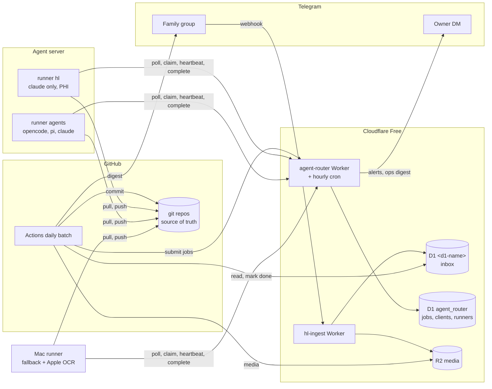
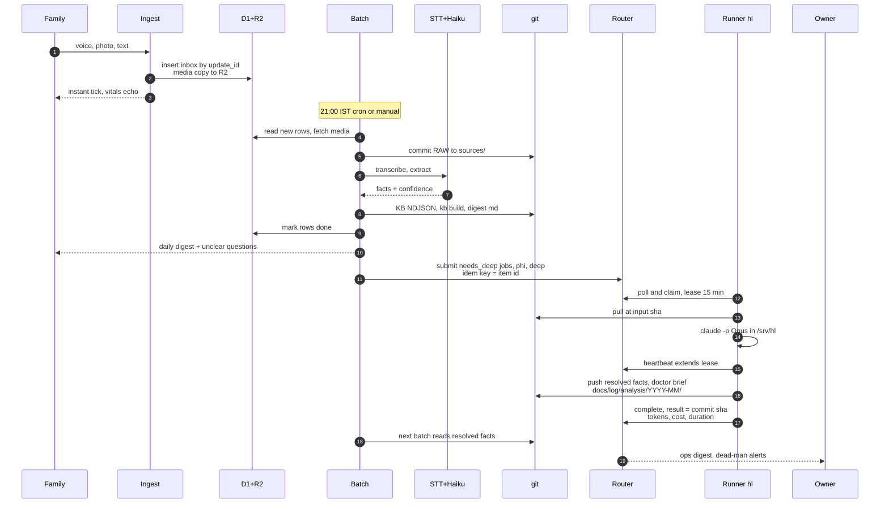

# 006 — Unified platform: Saturn + agent router

Date: 2026-10-25 · Status: **SUPERSEDED IN PART** by the [HLD](../platform/hld.md) (2026-10-25); the remainder stays proposed · Superseded-by (in part): [hld.md](../platform/hld.md) · Builds on: 003, 004, 005 (ingest-only Worker + daily batch, in progress) · Research: [cost-and-infra-2026-10.md](../research/cost-and-infra-2026-10.md)

Where this ADR and the HLD (or the [hl-service design](../platform/hl-service-design.md) / the agent-service design in the agent-server repo) differ, the HLD wins. Names below (`hl-ingest`, `agent-router`, D1 database names) are template defaults; concrete resource names live in the env repo. Wherever this ADR says "subscription", the subscription-vs-API choice (and its terms of service) is an env choice. Deployment specifics (hosts and providers chosen, costs, accounts, subscriptions) live in the environment repo.

## Context
There are two plans with overlapping parts. **Saturn** (ADR 005) is a Telegram webhook into a CF Worker, then D1/R2, then a daily GitHub Actions batch, then git, with hard work sent to a `needs_deep` queue. The **agent server** (option D, not started) is an always-on VPS running the opencode, pi and `claude` CLIs and the Paseo daemon, with git as the source of truth and the Mac and phone as screens. The server host (free tier with reclaim risk, or a small paid VPS) is a deployment choice. This ADR folds both into one design: the server becomes a general **agent router** for async agent jobs, and Saturn is its first tenant.

## Decision (summary)
1. **Cloudflare (Free plan) is the only always-on, inbound-facing tier.** It runs two Workers: `hl-ingest` (ADR 005) and `agent-router` (new; owns the job queue in its own D1 database). Every other component only makes outbound calls.
2. **The queue is a D1 `jobs` table, and runners poll it over HTTPS.** Runners on the server and the Mac claim jobs under a lease. Delivery is at-least-once, with retries and a dead-letter state. Durable Objects are rejected for now (below).
3. **GitHub Actions keeps the deterministic daily batch.** The batch does not depend on the server. It *submits* hard work to the router; it never waits for it.
4. **Runners execute.** There is one runner binary per Unix user. The `hl` user is PHI-only and Claude-only. The `agents` user runs general jobs on any tier. The Mac runs the same binary as a fallback.
5. **`data_class` is enforced three times:** at submit (client scope), at claim (runner scope) and in the runner (harness allow-list). PHI goes only to Anthropic.

## Components


## Sequence: family message to final reports

If the router or a runner is down, steps 11–18 wait. Steps 1–10 never depend on them. `needs_deep` is also written to git in step 8, so a manual Mac session can always drain it.

## Placement
| Component | Where | Why | Failure behaviour |
|---|---|---|---|
| Telegram ingest | CF Worker `hl-ingest` | inbound, always on, $0, no patching | Telegram retries ≤24 h; D1/R2 are durable |
| Job queue + API | CF Worker `agent-router` + D1 | reachable by all clients; survives server loss | submit fails → batch keeps `needs_deep` in git and re-submits next run (idempotent) |
| Daily batch, digest | GitHub Actions | free 2,000 min; independent of server and Mac; emails on failure | inbox grows; next run catches up |
| Cheap extraction | small-model API + STT, called from Actions | cheap; must run when the server is down | retry next run |
| Opus / deep jobs | server runner `hl` (claude CLI, subscription) | $0 marginal; long-running | lease expires → re-queued; Mac runner may claim |
| General agent jobs | server runner `agents` | any tier, never PHI | queued until a runner is up |
| OCR, `<media-dir>` | Mac | Apple Vision is macOS-only; keeps the media folder (PHI) off the VPS | documents wait |
| Truth | git (private org) | ADR 003/004 | every clone holds the full history |

**Is CF still preferred? Yes, for exactly these:** anything inbound, anything always-on, and small state (inbox, queue). It does no compute beyond ~10 ms CPU (Free plan limit). Do not run LLM calls or media processing in Workers.

## Job contract
```sql
CREATE TABLE jobs (
  id TEXT PRIMARY KEY,               -- ulid
  client TEXT NOT NULL,              -- clients.id (token owner)
  idem_key TEXT NOT NULL,            -- UNIQUE(client, idem_key): re-submit returns existing job
  kind TEXT NOT NULL,                -- 'agent' | 'shell' (shell = fixed script in repo)
  tier TEXT NOT NULL,                -- min capability: 'free'|'cheap'|'standard'|'deep'
  harness TEXT,                      -- optional pin: 'claude'|'pi'|'opencode'
  model TEXT,                        -- optional pin, else from policy
  data_class TEXT NOT NULL,          -- 'public'|'internal'|'phi'
  priority INTEGER NOT NULL DEFAULT 5, -- 0 high .. 9 low
  repo TEXT, ref TEXT, workdir TEXT, -- e.g. <org>/<records-repo> @ sha
  prompt TEXT NOT NULL,              -- task, or path to prompt file in repo
  inputs TEXT,                       -- JSON refs: git paths, r2 keys. phi: refs only, no inline data
  output TEXT NOT NULL,              -- JSON: {type:'git_commit'|'git_pr'|'r2', path, schema?}
  budget TEXT NOT NULL,              -- JSON: {max_usd, max_turns, timeout_s}
  callback TEXT,                     -- optional HTTPS URL, HMAC-signed POST on terminal state
  state TEXT NOT NULL DEFAULT 'queued', -- queued|leased|done|failed|dead|cancelled
  not_before INTEGER, lease_owner TEXT, lease_token TEXT, lease_until INTEGER,
  attempts INTEGER NOT NULL DEFAULT 0, max_attempts INTEGER NOT NULL DEFAULT 3,
  result_ref TEXT, error TEXT,       -- commit sha / PR url / r2 key. never result bodies
  used_harness TEXT, used_model TEXT, tokens_in INTEGER, tokens_out INTEGER,
  cost_usd REAL, duration_ms INTEGER, created_at INTEGER, updated_at INTEGER,
  UNIQUE (client, idem_key)
);
CREATE INDEX jobs_ready ON jobs (state, priority, created_at);
-- clients(id, token_sha256, scopes JSON: {submit_classes, repos, claim_classes, harnesses, admin})
-- runners(id, client, last_seen, version, paused)
```
- **Claim** (one atomic statement, since D1 has a single writer): `UPDATE jobs SET state='leased', lease_owner=?, lease_token=?, lease_until=now+900, attempts=attempts+1 WHERE id=(SELECT id FROM jobs WHERE (state='queued' OR (state='leased' AND lease_until<now)) AND (not_before IS NULL OR not_before<=now) AND data_class IN (<runner scope>) AND tier IN (<runner tiers>) ORDER BY priority, created_at LIMIT 1) RETURNING *`.
- **Lease = visibility timeout.** Default 15 min; the runner heartbeats every 5 min. `complete`, `fail` and `heartbeat` must present the `lease_token` (a fencing token), so a zombie runner whose lease expired cannot overwrite the result.
- **At-least-once.** Jobs must be idempotent. The output goes to a deterministic location (`jobs/<id>` branch, or a fixed path at a pinned `ref`). A duplicate run produces the same diff, or an empty commit that gets skipped.
- **Retries.** Retryable errors (harness crash, network, timeout) re-queue with `not_before = now + 2^attempts min`. A **quota** error re-queues at the quota reset time and does not consume an attempt. A contract error (bad output schema, data_class violation) goes straight to `dead`. `attempts ≥ max_attempts` also means `dead` (the dead-letter state; no separate queue). Dead jobs appear in the ops digest; `POST /jobs/:id/retry` revives one.

## Routing policy
The `tier` field is the *minimum* capability. The router picks the cheapest allowed option with quota left, and it never routes outside the data_class allow-list.

| Tier | Harness → model | Cost | Allowed data_class | Fallback on quota or error |
|---|---|---|---|---|
| free | opencode → free hosted open models | $0 | public | cheap |
| cheap | pi → DeepSeek flash | ~$0.3/$1.2 per MTok | public, internal | standard |
| standard | claude CLI → Haiku/Sonnet (subscription) | $0 marginal | all | Anthropic API (key with spend cap) only if `budget.max_usd>0`, else wait |
| deep | claude CLI → Opus (subscription) | $0 marginal | all | wait for reset. No downgrade, no API Opus unless pinned + budget |

- **PHI** goes only to the claude CLI or the Anthropic API. It never goes to DeepSeek, free hosted endpoints, or the Gemini/OpenAI free tiers. The claim query and the runner both enforce this, so even a misconfigured client can't route PHI elsewhere.
- **Subscription guard.** Automated jobs may use at most N deep jobs per day (default 10) and at most one concurrent claude session per runner. This leaves the plan's own usage limits for interactive work. Reaching the cap means `not_before = tomorrow`; it is not an error.
- **Concurrency.** `hl` runs 1 job and `agents` runs a small number sized to the server's memory. The Mac runs 1, and only while awake.

## Comms and auth
- **Outbound-only from the runners:** HTTPS to `agent-router` (poll every 60 s, backing off to 5 min after 1 h idle; about 1.5–3k requests/day against Free's 100k/day) and git over SSH to GitHub. There are no inbound ports, NAT is fine, and downtime only delays jobs.
- **Tailscale is the admin plane only:** SSH, Paseo, and this diagram page. There is **no Funnel and no CF Tunnel**, because nothing needs inbound. CF Workers cannot join a tailnet, and with this design they don't need to. GitHub Actions *can* join, as an ephemeral, tagged node via `tailscale/github-action` (OIDC/OAuth/auth key; the node is removed after the run; https://tailscale.com/kb/1276/tailscale-github-action). That is unneeded here; keep it for a future "deploy to server" step.
- **Auth:** per-client 256-bit bearer tokens, stored in D1 only as SHA-256. Scopes are per token: Saturn batch = submit `phi` to the records repo. Runner `hl` = claim `phi` only. Runner `agents` = claim `public|internal`. Owner = admin (pause, retry, cancel). CF Access service tokens are an extra layer that isn't needed; the docs (https://developers.cloudflare.com/cloudflare-one/identity/service-tokens/) don't state whether they're on the Free plan, so I didn't check further. Callbacks are HMAC-signed with a per-client secret.
- **Remote control and deploys:** a `paused` flag per runner and globally (an admin endpoint, or a D1 row). The runners self-update from git: a systemd timer runs `git pull` + restart at a pinned tag. The server is provisioned from one cloud-init script in an `agent-server` repo, so a reclaimed instance is ~15 min to rebuild.

## Storage
- **Needed:** D1 (inbox, jobs), R2 (media until it is committed; ADR 005), git (truth). All of it is on CF Free: D1 has 5 M rows read/day, 100 k writes/day and 5 GB; Queues and cron are not needed by the router (https://developers.cloudflare.com/workers/platform/pricing/).
- **KV: no.** It is eventually consistent, has 1 k writes/day, and is not needed for anything here.
- **Durable Objects: available on Workers Free (SQLite backend only)**, with 100 k requests/day, 13 k GB-s/day and 5 GB (https://developers.cloudflare.com/durable-objects/platform/pricing/). **They don't earn their complexity yet.** A DO queue with hibernated WebSockets gives push latency in milliseconds, but the jobs are batch work measured in minutes. It would add a DO class, alarms for lease expiry, reconnect logic and a second storage model. Revisit only if interactive (sub-second) dispatch becomes a requirement. The job contract doesn't change, so the migration would be cheap.
- **Git as the queue: no** for the router: there is no atomic claim, pushes race, and there are no leases. Git stays the *fallback* durable list (`needs_deep`) and the result store.
- **SQLite on the server: no** for the queue: it is unreachable when the server is down, and it needs inbound access or a tailnet join from clients. Runners keep only local scratch.

## Logging and observability (minimal)
- The **`jobs` table is the audit log:** harness, model, tokens, cost, duration, attempts, status and error per job. Rows are kept 90 days, then a monthly NDJSON export goes to the router repo.
- **Workers Logs on Free: 3-day retention, 200 k events/day** (https://developers.cloudflare.com/workers/observability/logs/workers-logs/). That's enough for debugging. Don't log bodies, only ids and status.
- **Server:** journald per systemd unit. Per-job transcripts go in the runner user's workdir (0700) with 30-day local retention. PHI transcripts never leave `/srv/hl`.
- **Dead-man's switch:** the router's hourly cron alerts the owner by Telegram DM when a runner's `last_seen` is over 2 h old, the oldest queued job is past its SLA (deep: 24 h), `dead` is above 0 and new, or Saturn's `last_batch_at` is over 26 h old. If the CF cron itself fails, the owner notices the **missing** daily ops digest, and GitHub emails on Actions failure.
- **Daily ops digest** (router cron, 1 DM): jobs by state, $ spent, quota used per harness, dead letters, runner versions.

## Data protection (PHI)
- **`data_class` policy:** see the routing table. PHI `inputs` must be refs (git path at sha, or an R2 key). Results are never stored in D1, only `result_ref`. The router DB holds only short PHI prompts.
- **Unix isolation:** user `hl` owns `/srv/hl` (0700), has its own deploy key (records repo only), its own `claude` login, and no opencode/pi binaries on its PATH. User `agents` cannot read `/srv/hl`. No `<media-dir>` on the VPS; jobs fetch only the R2 objects they need into tmp and wipe them afterwards.
- **Secrets:** none in git. Per-user files at 0600 are loaded through systemd `LoadCredential`. Router tokens are hashed. The Anthropic API key has a console spend cap (value: deployment). Rotation = issue a new token, then delete the old row.
- **Provider terms caveat:** which terms PHI travels under (a consumer plan through the claude CLI or commercial API terms) is an env choice. Whatever is chosen, model training must be **off** (open question 2).

## Cost delta vs ADR 005
The router adds no Cloudflare cost on the Free plan (pricing pages above). Model cost depends on the subscription-vs-API choice and the fallback cap; the server cost depends on the host. Saturn's own cost is unchanged: the server is paid for by the agent plan, not by Saturn. The concrete figures for a deployment live in the environment repo.

## Asymmetric risks
- **PHI leaks to a provider that logs or trains:** irreversible. Prevented by three layers of enforcement plus Unix separation, at a cost of ~1 run.
- **Automated jobs drain the plan's usage limits:** the downside is losing interactive Claude for days; the cap costs one config value.
- **Server lost (free-tier reclaim, outage):** the downside is delay only. The queue lives in D1, truth in git, and the Mac drains. The rebuild is scripted.
- **Router down:** the family is unaffected. The batch keeps `needs_deep` in git and re-submits.
- **Duplicate execution (at-least-once):** at worst a duplicate PR or an empty commit. Fencing tokens stop stale writes.
- **Building DOs/push now:** permanent complexity for latency nobody needs.

## Phased rollout
| Phase | Scope | Agent-runs |
|---|---|---|
| 0 | ADR 005 as is: ingest Worker + daily batch + digest. `needs_deep` in git, drained manually on the Mac. **The family can start.** | 0 beyond 005 |
| 1 | `agent-router` Worker + D1 schema + token scopes. Runner (single file) on the Mac with the claude harness. The batch submits `needs_deep` + a weekly doctor-brief job. | 2 |
| 2 | VPS cloud-init (`agent-server` repo): users `hl`/`agents`, systemd, Tailscale, self-update. Dead-man cron + ops digest. | 2 (+ manual logins) |
| 3 | pi/opencode adapters, quota tracking, fallbacks; other apps as tenants. | 2 |
| 4 | Only on demand: DO push dispatch, PaddleOCR on the server. | 1–2 each |

## Open questions
1. VPS host: a free tier (reclaim risk) or a small paid VPS? (A deployment choice; recorded in the environment repo.)
2. Is the Claude account's "help improve Claude" training setting off? If not, should PHI go over the API key only?
3. What cap on automated deep jobs per day (default 10)?
4. Should PHI results go straight to `main` or through a PR for review? (Recommended: PR for doctor briefs and medication facts, per ADR 004's human tier.)
5. Router code: a separate agent-router repo (recommended; became the agent-server repo), or inside Saturn?
6. Is the Mac a permanent PHI runner, or a fallback only?
