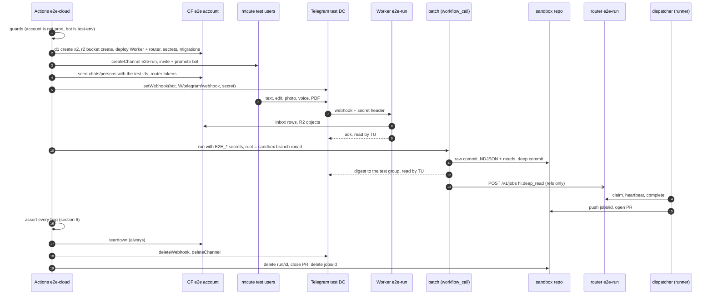

# E2E testing across hl-service and agent-service (2026-10-25)

Status: **PROPOSED**. The T1 batch half is implemented (`app/scripts/e2e-local.mjs`). Scope: [hld](hld.md), [hl-service-design](hl-service-design.md), ADR 005, and the agent-server repo (README, RUNBOOK, `test/`).
**Hard rule:** every byte in every tier is **synthetic and disposable**. No tier touches the prod bot (`<bot>`), D1 `<d1-name>`, R2 `<bucket>`, Worker `<worker>`, or any records repo. The only exception is a read-only `GET /health`.

## 1. Verdicts from primary docs
- **Telegram has a real, separate test environment.** It is "completely separate from the main environment", so you need "a new user account and a new bot with @BotFather". BotFather exists there and issues test-only tokens. Bot API calls use `https://api.telegram.org/bot<token>/test/METHOD` ([bots/webapps § test env](https://core.telegram.org/bots/webapps#using-bots-in-the-test-environment)).
- **Test users.** Numbers are `99966XYYYY` (X = DC 1–3), and the login code is X repeated five times. Each number gets a limited number of logins per day (example: 5), then FLOOD until the next day. Telegram also says "we periodically wipe all information stored there" ([api/auth § test accounts](https://core.telegram.org/api/auth#test-accounts)). Consequences: **log in once and keep the session string as a secret**, and make the bootstrap re-runnable for after a wipe.
- **Headless user client: mtcute** (TS, matching our stack). `testMode: true` "**must** be passed if using test servers", and the default is test DC 2 ([MtClientOptions](https://ref.mtcute.dev/interfaces/_mtcute_web.index.MtClientOptions)). Telethon also works, via `session.set_dc(2,'149.154.167.40',80)` ([Telethon test servers](https://docs.telethon.dev/en/stable/developing/test-servers.html)). Every client needs an `api_id`/`api_hash` from my.telegram.org ([API terms §2.1](https://core.telegram.org/api/terms)). The terms only forbid acting "without the user's knowledge and consent" (§1.4). They say nothing about userbots or the test DC, and our test accounts are our own.
- **Groups can be created and deleted by the API, by users only:** [`channels.createChannel`](https://core.telegram.org/method/channels.createChannel) (`megagroup`; can fail with `CHANNELS_TOO_MUCH`, hence the janitor), [`channels.inviteToChannel`](https://core.telegram.org/method/channels.inviteToChannel) to add the bot, `channels.editAdmin` to make the bot admin, and [`channels.deleteChannel`](https://core.telegram.org/method/channels.deleteChannel).
- **Bots cannot be created headlessly.** You get them from BotFather, or as Bot API 9.6 "managed bots", which still need a user tap ([changelog](https://core.telegram.org/bots/api-changelog)). So we keep a **pool of 2 pre-made test-env bots**. The bootstrap script can create them by having a test user DM `/newbot` to the test-env BotFather once. That is semi-automatic, never run per test run.
- **OSS precedent.** [tgintegration](https://pypi.org/project/tgintegration/) drives bots from a real user session (Pyrogram; a TS/mtcute port is on [jsr](https://jsr.io/@tgintegration/core)). [python-telegram-bot](https://github.com/python-telegram-bot/python-telegram-bot/blob/master/tests/README.rst) runs CI against live Telegram with dedicated per-job bots. Cloudflare's own testing tools are local workerd ([vitest integration](https://developers.cloudflare.com/workers/testing/vitest-integration/), [`getPlatformProxy`](https://developers.cloudflare.com/workers/wrangler/api/#getplatformproxy)). We follow the same split: mocks below, a real user client at the top.

## 2. Tiers
| Tier | Covers | Runtime | Cost | Flakiness | Trigger |
|---|---|---|---|---|---|
| **T0 unit** | hl: 108 vitest (ingest, rules, extraction parse, batch steps on node:sqlite). agent: router units, leases, fencing, caps (`node --test`) | <10 s | $0 | ~0 | every push / PR |
| **T1 local-integrated** | hl `npm run e2e:local`: wrangler dev (workerd) + local D1/R2 + stub Telegram, then the **real batch CLI** (`pull`/`extract`/`finish`) against the same local D1/R2 through a fake CF REST API, `scripts/fake-claude.mjs`, the KB build. agent `npm run test:e2e`: wrangler dev router + real dispatcher + mock harness. *Planned:* the hl submit → local router → dispatcher → `git_pr` into a local bare repo | 1–2 min | $0 | low (ports, workerd start) | PRs touching `app/` or `agent-server`; pre-deploy |
| **T2 cloud-ephemeral** | the real Telegram **test** DC (user client → test bot → webhook) → a per-run Worker + D1 + R2 in the **e2e CF account** → the batch as a reusable workflow on a **sandbox repo** branch → digest in the test group → a per-run router Worker + D1 → the dispatcher on the runner (fake claude) → a PR on the sandbox repo | 6–12 min | $0 (CF Free, ~10 Actions min/run) | medium (test DC, Telegram delivery latency) | nightly 03:00 UTC, manual, release label |
| **T3 real-model** | T2 with the real `claude -p`: Haiku extraction on ~4 synthetic messages + one `hl.deep_read` on a synthetic PDF (`max_turns` ≤5) | 10–20 min | subscription usage only (~5 calls) | medium-high (limits, model drift: assert schema and shape, not wording) | weekly, manual; never within 2 h of the 15:37 UTC prod batch |

## 3. One T2 run

## 4. Resource lifecycle
- **Name.** `e2e-<run_id>-<attempt>` for every resource (Workers `e2e-…-hl` and `e2e-…-router`, D1 x2, one bucket, the group title, the branch `run/<…>`). The run id is also stamped in D1 `chats.label` notes and in commit messages.
- **Create.** Run the guards first (section 7). Render `wrangler.e2e.toml` from `deploy/wrangler.template.toml` with the e2e env values: the per-run name, D1 id and bucket. `wrangler deploy --config`, `wrangler secret bulk`, `d1 migrations apply --remote`. Seed the allowlist with the test user ids and the new group id. Then `setWebhook` with `allowed_updates=["message","edited_message"]`.
- **Run, then assert.** Section 6. Each assertion polls with a deadline, and Telegram hops get ≤60 s.
- **Teardown** (`if: always()`, every step `|| true`). `deleteWebhook`, `deleteChannel`, `wrangler delete` for both Workers, `d1 delete -y` for both. Empty the bucket, then `r2 bucket delete`. Delete the sandbox branches and close the PR.
- **Janitor** (a cron in the same workflow, plus a manual run). Delete every `e2e-*` Worker, D1 and bucket older than 6 h (D1 Free allows **10 databases per account**, so a leak blocks runs: [D1 limits](https://developers.cloudflare.com/d1/platform/limits/); Workers allow 100/account: [limits](https://developers.cloudflare.com/workers/platform/limits/)). Delete the test user's `e2e-*` groups, and `run/*` and `jobs/*` branches older than 1 day. It also gives the bucket a 1-day lifecycle rule as a backstop.
- **Not used.** Workers Preview/version URLs share the production Worker's bindings unless overridden ([previews](https://developers.cloudflare.com/workers/configuration/previews/)), and `[env.e2e]` gives fixed names, not per-run ones ([environments](https://developers.cloudflare.com/workers/wrangler/environments/)). Both are weaker than per-run names in a separate account.

## 5. Scenario matrix
| # | Scenario | How | T1 | T2 | T3 |
|---|---|---|---|---|---|
| 1 | Happy text vitals | user sends `120/80 72` | ✓ | ✓ | ✓ |
| 2 | Webhook secret mismatch | direct POST with a wrong secret → 401; plus `setWebhook` with a wrong secret → `getWebhookInfo.last_error_message`, then fix | ✓ | ✓ | |
| 3 | Idempotent redelivery | T1: same update twice. T2: `deleteWebhook`, send, `setWebhook` (Telegram queues ≤24 h and delivers), then replay the captured update by POST | ✓ | ✓ | |
| 4 | Edit | `messages.editMessage` → `edited_message` → "सुधार: …" ack, one corrected fact | unit | ✓ | ✓ |
| 5 | Photo / PDF media | synthetic PNG of a BP display; a synthetic one-page PDF → `needs_deep` | ✓ | ✓ | ✓ |
| 6 | Voice, no Sarvam | synthetic OGG/Opus tone; no `SARVAM_API_KEY` → "🎤 … transcription pending" | unit | ✓ | |
| 7 | Claude auth or limit failure | `FAKE_CLAUDE_MODE=auth\|limit` → exit 3, "⚠ extraction delayed", rows stay `new`; the next run extracts | ✓ | ✓ | |
| 8 | Stranger / other chat | second test user outside the allowlist; an unlisted group → stored or ignored, no reply | unit | ✓ | |
| 9 | Agent-service down | `AGENT_ROUTER_URL` → closed port; batch green, item stays `open`; next run with the router up → 200 existing / 201 | planned | ✓ | |
| 10 | Lease expiry | `LEASE_S=20`, `MOCK_MODE=sleep`, kill dispatcher 1 → dispatcher 2 reclaims; the zombie gets 409 `lease-lost` | unit | ✓ | |
| 11 | Deep read → PR | dispatcher `hl.deep_read` → PR on `jobs/<id>` with the `done` line | planned | ✓ | ✓ |
| 12 | Batch rerun | dispatch twice → no duplicate rows, no second digest with `send_digest=false` | unit | ✓ | |

## 6. Assertions per hop
| Hop | Assert |
|---|---|
| user → bot | mtcute gets the bot's ack in the group within 60 s, with the exact text ("BP 120/80, pulse 72 ✓"); the ack `reply_to` is the sent message |
| webhook → Worker | `getWebhookInfo`: `pending_update_count` 0, no `last_error_*`; wrong secret → 401 |
| Worker → D1 / R2 | one inbox row per `update_id` (kind, person, `media_status=stored`); the R2 object bytes equal the fixture's SHA-256 |
| batch pull → git | `data/telegram/raw/*.jsonl` row count; the media file in `sources/<person>/media/telegram/`, matching by hash; commit `data: telegram raw` on `run/<id>` |
| extract → KB | NDJSON has the BP reading, the edit supersedes, voice is `stt_pending`, the PDF is in `needs_deep.jsonl`; `tools/kb/build` prints `ok:` |
| finish → Telegram | inbox rows `done`; one digest DM to the admin containing the question and the voice/PDF lines; no message to the group or any other chat (ADR 011) |
| batch → router | the job exists with `data_class=phi`, params ≤2 KB with refs only, `idempotency_key=deep:<chat>:<msg>`; a resubmit → 200 |
| router → dispatcher | `queued → leased → done`; heartbeat seen; `used.harness=claude`; for T3, `apiKeySource: none` |
| dispatcher → PR | a PR on the sandbox repo from `jobs/<id>`; the diff touches only `data/queue/needs_deep.jsonl` and `data/<person>/docs/`; `result_ref` = PR URL |
| global | no request ever hits `api.telegram.org/bot<prod>` or the prod account (guards); the Actions log has counts only |

## 7. Isolation: prod cannot be touched
- **Cloudflare: a separate free account (feasible).** Name-scoped tokens are not. R2 tokens can be scoped to buckets, but D1 and Workers Scripts permissions are **account-wide**, with no per-database or per-script scoping ([permissions](https://developers.cloudflare.com/fundamentals/api/reference/permissions/), [R2 tokens](https://developers.cloudflare.com/r2/api/tokens/)). The dashboard can create **up to 5 Free accounts** once the user has 7 days of tenure ([changelog 2026-08-04](https://developers.cloudflare.com/changelog/post/2026-08-04-free-dashboard-button/)). The e2e token is minted with "Account resources: e2e account only": Workers Scripts Edit, D1 Edit, Workers R2 Storage Edit, Account Settings Read.
- **Guards** (the first step, which fails closed):
  - `GET /accounts/$E2E_CF_ACCOUNT_ID/workers/scripts` must not list the prod Worker name (from the prod `env.yaml`, compared by hash).
  - D1 must not list the prod D1 name (same).
  - The account id must not equal `sha256` `vars.PROD_CF_ACCOUNT_SHA`.
  - The bot: `getMe` on `/bot<t>/test/getMe` must be ok, **and** on prod `/bot<t>/getMe` must be 401. That proves a test-env token.
- **GitHub.** Separate `E2E_*` repo secrets, mapped explicitly into `workflow_call`. Environment secrets are not an option: on Free they work only in public repos ([environments](https://docs.github.com/en/actions/reference/workflows-and-actions/deployments-and-environments)). Every git write goes to a **separate synthetic repo `<e2e-sandbox-repo>`**, through a fine-grained token scoped to that repo only, so a bug cannot push to a real records repo or read its data. The batch runs with `--records` set to the sandbox checkout, never to a real records checkout. Pushes made with `GITHUB_TOKEN` do not start new runs, so `deploy-worker` can never fire ([GITHUB_TOKEN](https://docs.github.com/en/actions/concepts/security/github_token)).
- **Telegram and Claude.** Telegram has separate test-DC accounts and bots, and its test data is wiped and not private, which suits synthetic data. T3 uses a separate `claude setup-token` (`E2E_CLAUDE_CODE_OAUTH_TOKEN`), revocable on its own.

## 8. Secrets (test-env only; never a prod value)
| Secret | What |
|---|---|
| `E2E_CF_API_TOKEN`, `E2E_CF_ACCOUNT_ID` | the e2e CF account token (scopes above) |
| `E2E_TG_BOT_TOKEN_A`, `_B` | the test-env bot pool; a concurrency group per bot (a webhook is per bot) |
| `E2E_TG_API_ID`, `E2E_TG_API_HASH` | an my.telegram.org app "hl-e2e" |
| `E2E_TG_SESSION_ALICE`, `E2E_TG_SESSION_MAINTAINER`, `E2E_TG_SESSION_STRANGER` | mtcute session strings for the +99966 users (each logs in once, which avoids the login FLOOD limit) |
| `E2E_SANDBOX_TOKEN` | fine-grained PAT: contents + pull requests on `<e2e-sandbox-repo>` only |
| `E2E_CLAUDE_CODE_OAUTH_TOKEN` | T3 only |
| var `PROD_CF_ACCOUNT_SHA` | a hash of the prod account id, used by the guard |

## 9. Implementation plan (agent-runs)
| # | Step | Size | Gate |
|---|---|---|---|
| 1 | **Done here:** T1 batch half. `CLOUDFLARE_API_BASE` / `TELEGRAM_API_BASE` seams (the defaults are unchanged); `scripts/fake-claude.mjs`; `e2e-local.mjs` steps 6–9 (pull, delayed extract, extract, KB, finish) | — | `npm run e2e:local` passes |
| 2 | Telegram adapter `TELEGRAM_TEST_ENV=1` (`/bot<t>/test/…`); `daily-batch.yml` → `workflow_call` with inputs `root_repo`, `branch`, and the `secrets` map; `commit-push.sh` targets the input branch | 1 | T0/T1 green; prod schedule unchanged |
| 3 | T1 cross-service: hl agent client (hl-service-design step 4) + agent-server `git_pr` delivery (phase 2) → e2e against a local bare repo | 2 | scenarios 9–11 in T1 |
| 4 | `e2e-cloud.yml`: guards, create, teardown, janitor scripts (bash + wrangler + curl) | 1 | a run with no Telegram leaves 0 resources; the janitor deletes a planted leak |
| 5 | mtcute driver (`e2e/tg.ts`): bootstrap (sign up test users, create bots via BotFather, print sessions to stdin-only `gh secret set`); per-run group, sends, edits, read replies | 1 | scenarios 1–8 green 5 nights running |
| 6 | Agent-service in T2: ephemeral router Worker + D1, dispatcher on the runner, sandbox PR | 1 | scenarios 9–12 |
| 7 | T3 toggle (real claude, weekly) + a flake budget (one auto-retry for Telegram hops) | 0.5 | one green weekly run |
Total: **~6.5 agent-runs**, of which steps 3 and 6 wait on agent-server phase 2 (`git_pr`).

**User actions:**
1. Create the second CF Free account, complete R2 there, and mint the e2e token.
2. Create an my.telegram.org app; the account it needs must be a real one.
3. Create the `<e2e-sandbox-repo>` repo and its PAT.
4. Run the step 5 bootstrap once, locally.
5. For T3, create a second `claude setup-token`.

## 10. Open questions
- `setWebhook` to a `<worker>.<subdomain>.workers.dev` URL from the test environment, and the file-download path (`/file/bot<t>/test/<path>`?), are **unverified**. They are the first thing step 5 must prove; the fallback is `getUpdates` polling in the runner, which replays updates into the Worker.
- Does R2 in a new account need its own payment-method checkout (it may)? If it blocks, keep media on a bucket-scoped R2 token in prod's account. That is weaker, and only R2 is shared.
- How often does the test DC wipe accounts? The bootstrap must be idempotent; we track wipes by a guard failure ("session revoked").
- T2 cadence vs the Actions budget: ~10 min × 30 nights ≈ 300 of 2,000 min/month (private repo). Is nightly worth it, or only on release?
- Is a voice note from a user client in the test DC delivered with `voice.duration` and `mime_type` as in prod? Assert loosely.
