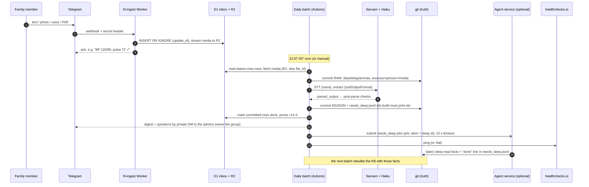

# hl-service: design (target state)

Date: 2026-10-25 · Status: PROPOSED (design only; no code changed) · Builds on ADR 003/004/005; consumes ADR 006's job contract without depending on it · Full OSS review and GitHub Actions cost: [oss-review-hl-service.md](oss-review-hl-service.md)

## Responsibilities
hl-service is the Saturn capture-and-records service for a home health log. It does six things:
- **Capture.** It receives the Telegram family group (text, photos, voice, PDFs) and stores every update durably. The group is input-only (ADR 011): no replies there; optional acks go only to an admin's private chat.
- **Daily batch.** It moves raw data from D1 and R2 into git. It runs STT (Sarvam) and extraction (Haiku 5.5, schema-validated), rebuilds the KB, and DMs the daily English digest (records, pending items, questions, rule annotations, unverified) to the admins only (ADR 011).
- **Clinical KB.** NDJSON facts with provenance live in git and are rebuilt into SQLite with validation and views (ADR 004).
- **Document pipeline.** OCR sidecars (Apple Vision on a macOS workstation), the hard-read runbook, and `needs_deep` items.
- **Analysis outputs.** analysis notes and doctor briefs in the records repo, written by humans or agents as git commits.
- **Independence.** Every step above runs with the agent service absent. The agent service only drains `needs_deep` faster.

## Non-goals
- No real-time alerts, no LLM at ingest, no diagnosis or medication advice (README, ADR 005).
- No always-on server, no workflow engine, no ORM, no vault, no hosted dashboard for PHI.
- Not a generic agent platform. Routing, leases, quotas and runners belong to the agent service (ADR 006).

## Components and placement
| Component | Runs on | Code (target) | Notes |
|---|---|---|---|
| Ingest Worker (`<worker>`) | Cloudflare Workers **Free** | `app/src/worker.ts`, `ingest.ts`, `channel/telegram.ts`, `vitals.ts`, `store.ts` | Checks the secret (runtime `crypto.subtle.timingSafeEqual`), applies the allowlist, `INSERT OR IGNORE` by `update_id`, streams media to R2, sends the ack. ≤3 subrequests, well under 1 ms CPU |
| Inbox | D1 `<d1-name>` | `migrations/0001_init.sql` | `persons`, `chats`, `inbox`. A 14-day buffer, not a store of record |
| Media buffer | R2 `<bucket>` | binding | Second copy. Git `sources/` is canonical (ADR 003) |
| Daily batch | GitHub Actions `daily-batch.yml`, 15:37 UTC | `app/batch/run.ts`, `src/batch/*` | Three idempotent steps, `pull → extract → finish`, with commits between them |
| Extraction | Node, inside the batch | `extract/` | **an `LlmAdapter` (default `claude-cli`: `claude -p` with `--json-schema`, Haiku 5.5; the account type is an env choice)**, plus our post-parse validation, units, ranges and time normalisation (ADR 005 amendment; no Anthropic SDK) |
| STT | Node, inside the batch | `stt/` | **`sarvamai` SDK** behind the `SpeechToText` interface: REST for clips ≤30 s, batch job for longer ones |
| Rules + digest | Node, inside the batch | `rules/`, `batch/digest.ts`, `replies.ts` | Fixed English templates, never LLM text |
| KB build | Python stdlib, inside the batch and CI | `tools/kb/build`, `schema/schema.sql` | SQLite is the validator (CHECK/FK/ranges). `kb.sqlite` is gitignored |
| Query | workstation | `sqlite3` CLI; optionally `uvx datasette <records-dir>/data/kb.sqlite` locally | Never published |
| OCR + hard reads | macOS (Apple Vision); later OCRmyPDF + Tesseract `hin+eng` on Actions | `tools/ocr/`, `HARD-READ.md`, `tools/doc-scan/` | Hard reads go to the agent service as `phi` jobs, or are done in a manual session |
| Agent client (optional) | Node, inside the batch | `src/batch/agent.ts` (~40 lines, new) | Best-effort `POST /jobs`; a no-op without `AGENT_ROUTER_TOKEN` |
| Deploy | GitHub Actions `deploy-worker.yml` | — | Test → migrations → `wrangler deploy` → `wrangler secret bulk` |
| Monitoring | healthchecks.io (free) + digest heartbeat + GitHub failure email | — | One check: period 1 d, grace 3 h |

## Sequence: family message → digest and KB

Steps 1–14 never wait on the agent service. Step 15 is fire-and-forget. Results only ever arrive as git commits.

## Data stores
| Store | Holds | Authority | Retention / backup |
|---|---|---|---|
| git `<owner>/<records-repo>` (private) | raw updates, media (`sources/`), NDJSON KB, `needs_deep.jsonl`, OCR sidecars, analysis | **source of truth** | full history in every clone (workstation + Actions); a local clone is the offline backup |
| D1 `<d1-name>` | `persons`, `chats`, `inbox` | buffer until committed | rows deleted 14 d after `done`; Time Travel 7 d (Free) |
| R2 `<bucket>` | media copied at ingest | second copy | kept; optional bucket-lock rule (deferred) |
| `kb.sqlite` | the built KB | derived, rebuildable | gitignored |
| `<media-dir>` (workstation) | historic scans/crops kept outside git (ADR 002) | original archive | workstation backup; never on a VPS |

## Interface to the agent service
**Contract (v1).** This is a subset of ADR 006 `jobs`. hl-service depends on these fields only.
```http
POST {AGENT_ROUTER_URL}/v1/jobs           Authorization: Bearer <AGENT_ROUTER_TOKEN>  (scope: submit phi → records repo)
{ "idem_key": "deep:<chat-id>:14",   // the needs_deep id; re-submit returns the existing job
  "kind": "agent", "tier": "deep", "data_class": "phi", "harness": "claude",
  "repo": "<owner>/<records-repo>", "ref": "<sha of the batch commit>",
  "prompt": "tools/ocr/HARD-READ.md#needs_deep",           // a path in the repo, never inline PHI
  "inputs": { "queue_id": "deep:<chat-id>:14", "paths": ["sources/alice/media/telegram/u-doc1.pdf"] },
  "output": { "type": "git_commit", "path": "data/alice/docs/" },
  "budget": { "max_usd": 0, "max_turns": 40, "timeout_s": 1800 } }
→ 201 {"id": "...", "state": "queued"} | 200 (existing) | 4xx (contract error) | 5xx/timeout
```
- **`data_class = "phi"` is mandatory** for everything hl-service submits. Inputs are git refs and paths only, never message text, transcripts or media bytes. The router and runner enforce Claude-only routing (ADR 006). hl-service does not trust them to: it simply never sends content.
- **Completion is not part of the contract.** The runner appends `{"id":…,"status":"done"}` to `needs_deep.jsonl` and commits facts under `data/<person>/docs/`. The batch reads git and never polls the router, so hl-service has no runtime read dependency on the agent service.
- **Fallback when the service is unavailable.** The submit is skipped when the token is absent, and on timeout, 5xx or network error. The batch logs a count only, and the open item stays in `needs_deep.jsonl` (which is canonical) and is re-submitted next run (idempotent via `idem_key`). The digest shows "📄 kept for a careful read", as today. Anyone can drain the queue from a manual workstation session following the ADR 005 runbook. A 4xx is logged as a contract error and the batch does not fail.
- **Versioning.** The path has a `/v1` prefix. New optional fields are additive. A breaking change needs `/v2` while `/v1` is kept for one release.
- **Optional second job type:** a weekly `doctor-brief` (`tier: deep`, output `git_pr`, so a human reviews it, per ADR 006 open question 4).

## Deployments
- **Worker:** a push to `app/` on `main` runs `deploy-worker.yml`: `npm test`, typecheck, KB self-test, `wrangler d1 migrations apply --remote`, `wrangler deploy`, `wrangler secret bulk`. Roll back with `wrangler rollback <version>` ([deploy.md](deploy.md)). Actions are SHA-pinned at current majors (checkout/setup-node v4 run on the removed Node 20 runtime).
- **Batch:** code ships with the same push. The next cron uses it, and `workflow_dispatch` runs it at once. Disabling the workflow stops it; rows wait in D1.
- **Remote control:** GitHub web or mobile (dispatch, disable, re-run), `deleteWebhook`/`setWebhook` to stop or resume intake, and repo secrets for rotation. No SSH anywhere.
- **Dependencies:** Dependabot, weekly and grouped (`github-actions`, `npm` in `app/`, `pip` in `tools/doc-scan`). PRs run CI and auto-merge is off.

## Ops
- **Heartbeats:** (1) the admin's digest DM itself, missed when absent; (2) a healthchecks.io ping every run, `/fail` on error, emailing the owner after 27 h of silence; (3) GitHub emails on workflow failure.
- **Logs:** counts and ids only, never content (already enforced). Workers Logs on Free keep 3 days.
- **Spend caps:** Anthropic monthly limit $5, Sarvam training opt-out, GitHub Actions budget $0.
- **Ops cost per week:** ~0 when healthy. Answering the ❓ list is a family task, not an ops task.

## Cost (per month)
| Item | Expected |
|---|---|
| Cloudflare Workers/D1/R2 Free | $0 |
| GitHub Actions: ≈130–320 of 2,000 included minutes (private repo, Free org); overage $0.006/min Linux | $0 |
| Haiku 5.5 extraction | ≈$0.25–0.35 |
| Sarvam STT (₹0.49/min) | ≈$0.47 |
| healthchecks.io Hobbyist | $0 |
| Agent service | billed to ADR 006, not to hl-service |
| **Total** | **≈$0.7–0.9; high scenario ≈$2.5** |

Self-hosted runner fee: postponed indefinitely (GitHub changelog 2025-12-16), and we use no self-hosted runners anyway. Sources are in the review doc.

## Failure modes
| Failure | Effect | Recovery |
|---|---|---|
| Worker or D1 down | Telegram retries for ≤24 h | `wrangler rollback`. Updates older than 24 h are lost, so fix the same day |
| Actions cron delayed or dropped | the digest is late or missing; healthchecks alerts at 27 h | `workflow_dispatch`; rows wait in D1 (pruned only after commit) |
| Anthropic/Sarvam down | short ops DM to the admin ("extraction delayed"); no digest that run | retried automatically next run |
| LLM output fails the Zod parse | that item is dropped and listed under `rejected`; the message goes to ❓ and `needs_deep` | deep read or `retry_failed` |
| KB build rejects a row | raw and NDJSON are committed and the job fails (email) | fix the mapping or data, re-run |
| Agent service down or unreachable | `needs_deep` grows in git; the family sees no change | drains when it is back, or from a manual workstation session |
| Agent service writes a bad fact | it surfaces in `v_conflicts`/`v_needs_human`; doctor briefs come as PRs | `git revert`; facts carry `supersedes_id` |
| Push race | `commit-push.sh` rebases and retries 3× | re-run |
| Secret leak | — | rotate per [deploy.md](deploy.md) |
| Node 20 action runtime removed | the workflow fails at checkout/setup | bump actions (migration step 1) |

## OSS review summary
| Component | Verdict | Replacement / reason |
|---|---|---|
| Extraction schema + validation + SDK plumbing | **DONE differently** | SDK replaced by `claude -p --json-schema` behind the `LlmAdapter` (ADR 005 amendment, 2026-10-25); post-parse validation/units/ranges/time kept |
| Sarvam STT client + poll loop | **REPLACE** | official `sarvamai` SDK (`speechToTextJob…waitUntilComplete`), behind `SpeechToText`. −~120 lines. Pin it; re-check the licence |
| Secret compare | **REPLACE** | runtime `crypto.subtle.timingSafeEqual`. −6 |
| Deploy secret loop | **REPLACE** | `wrangler secret bulk`. −6 |
| `actions/checkout`/`setup-node` v4 | **REPLACE** | current majors, SHA-pinned (Node 20 removed 2026-09-23) |
| Dependabot, healthchecks.io | **ADD/ADOPT** | configuration only |
| Telegram adapter | KEEP | 3 endpoints; grammY adds ~27 KB gz and CPU on the always-on path. `@grammyjs/types` deferred |
| D1 Store / migrations | KEEP | 9 SQL statements over 3 backends; Drizzle is mid-1.0 RC. wrangler migrations is already the standard |
| Inbox idempotency, R2 streaming | KEEP | already the standard pattern / native bindings |
| Vitals parser, rules, digest templates, git layout | KEEP | domain logic with no OSS equivalent |
| Batch orchestration | KEEP | GHA steps are the orchestrator; every engine needs a server |
| `commit-push.sh` | KEEP | 17 lines versus a third-party action holding a write token to PHI |
| KB build/validation/views | KEEP | SQLite is the validator; JSON Schema/Frictionless would be a second schema |
| Query layer | DEFER | local Datasette when useful; never published |
| OCR | KEEP Vision / DEFER OCRmyPDF+Tesseract | Linux path only when macOS must not be required |
| Hard reads, doc-scan | KEEP | runbook / task-specific code on OpenCV |
| Workers test pool, gitleaks, R2 bucket lock | DEFER | pool needs vitest 4 (we are on 5); low value now |
| Secrets, backups | KEEP | repo secrets (Environments secrets are public-only on Free); git is the backup |

## Migration steps (from the current code)
| # | Step | Size | Gate |
|---|---|---|---|
| 1 | Ops hygiene: bump and SHA-pin actions; `dependabot.yml`; `wrangler secret bulk`; runtime `timingSafeEqual`; make `HEALTHCHECK_URL` required in the deploy runbook | **1 agent-run** | CI green; `npm run e2e:local` |
| 2 | Extraction → Zod 4 + `zodOutputFormat` (`schema.ts`, `claude.ts`, `steps.ts` call site); keep `parseExtraction` semantics (per-item drop, `rejected`, `outOfRange`) | **1 agent-run** | `test/extraction.test.ts`, `batch.test.ts` unchanged and passing; one live Haiku call on a fixture |
| 3 | STT → `sarvamai` SDK behind `SpeechToText`; delete the hand-rolled batch-job client and poll loop | **1 agent-run** | `sarvam.test.ts` rewritten against a mocked SDK; one live 40 s clip |
| 4 | Agent client `src/batch/agent.ts` + submit step after `finish` (no-op without a token) | **1 agent-run**, after ADR 006 phase 1 exists | fake-router test: 201/200/4xx/5xx/timeout all leave the batch green |
| 5 | Deferred, on trigger: OCRmyPDF+Tesseract CI job (when documents must not need a macOS workstation); vitest-pool-workers (when it supports vitest 5); R2 bucket lock | 1 run each | — |

Total to the target state: **3 agent-runs** now, **+1** when the agent service exists. Steps 1–3 are independent and can run in parallel worktrees.
