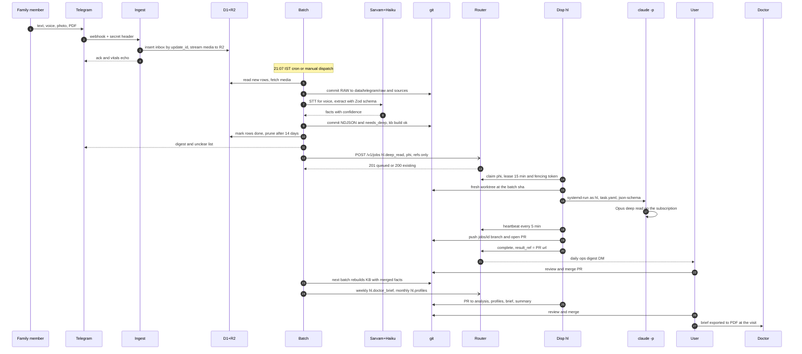
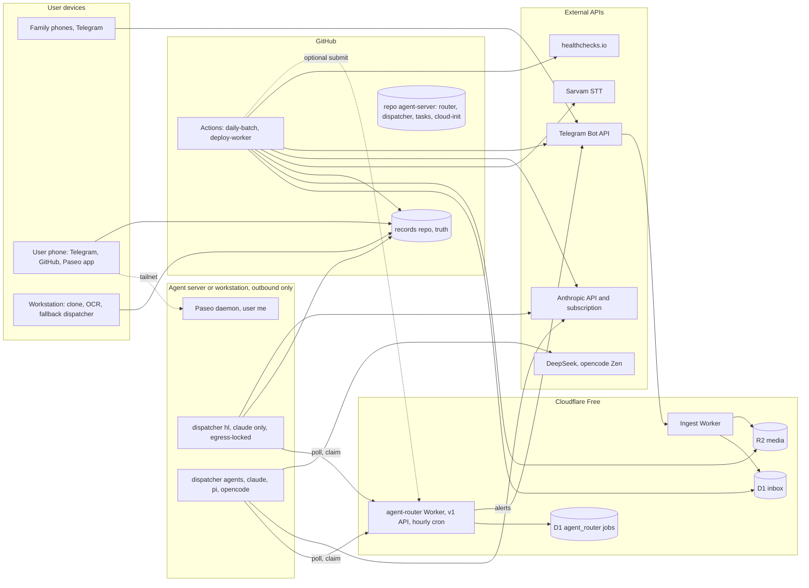

# HLD: hl-service + agent-service (2026-10-25)

Status: **PROPOSED**. It ties together [hl-service-design](hl-service-design.md) and agent-service-design (agent-server repo), and it supersedes ADR 006 where they differ. ADR 005 is implemented and unchanged. When the two design docs disagree, this HLD decides, and each decision is marked **(HLD)**.

**Headline.** There are two independent services with one contract between them. **hl-service** (Cloudflare Free + GitHub Actions) captures, extracts and digests on its own. **agent-service** (CF router + a dispatcher on a VPS, a home server or a workstation) drains the hard work. It is optional, and its results reach hl-service only as git PRs. Git is the only source of truth, and no medical data rests on the VPS.

## 1. System context
| Actor / system | Role | Talks to |
|---|---|---|
| Family members (the people whose health is logged) | send text, voice, photos and PDFs in the Telegram family group; read the digest (Hindi templates today) | Telegram |
| User (the maintainer) | answers the ❓ list, reviews PRs, runs sessions from a phone or workstation | GitHub, Paseo, Tailscale, Telegram DM |
| Doctors | receive the doctor brief as a PDF at a visit; no system access | the user |
| **hl-service** | capture, daily batch, KB, digest, analysis docs | Telegram, CF, GitHub, the `LlmAdapter` (default `claude -p`), Sarvam (optional, deferred), healthchecks.io, agent-service (optional) |
| **agent-service** | job API, routing, harness runs, interactive sessions | CF, GitHub, Anthropic (subscription or API, an env choice), DeepSeek, opencode Zen, Tailscale, Telegram DM |
| External | Telegram Bot API (webhook, keeps updates ≤24 h); Cloudflare (Workers, D1, R2, Free plan); GitHub (repos, Actions, 2,000 min); Anthropic **subscription** (`claude` CLI only; plan is an env choice) and **API** (Haiku extraction, fallback, spend-capped); DeepSeek and opencode Zen (non-PHI only); Sarvam (STT); Tailscale (admin plane); healthchecks.io (dead-man) | |

## 2. Service boundaries and the one contract
- **hl-service owns** the health data path end to end. It runs every day with the agent-service absent; the only effect of that absence is a growing `needs_deep.jsonl`.
- **agent-service owns** credentials, routing, quotas, leases, `data_class` enforcement and the audit trail. It stores no results, only refs.
- **The contract is `POST /v1/jobs`, and nothing else.** It uses the agent-service request shape with a task registry **(HLD)**: hl-service's ADR 006-style `prompt`/`kind`/`idem_key` example is replaced by the following.
  ```
  POST /v1/jobs  Bearer AGENT_ROUTER_TOKEN  (scope: submit phi, tasks hl.*, repo <records-repo>)
  {task:"hl.deep_read", params:{queue_id:"deep:<chat>:<msg>", paths:["sources/..."]},
   data_class:"phi", tier:"deep", idempotency_key:"deep:<chat>:<msg>",
   inputs:[{git:"<records-repo>@<batch sha>"}], output:{type:"git_pr", repo:"<records-repo>"},
   budget:{max_usd:0, max_turns:40, timeout_s:1800}}
  → 201 queued | 200 existing | 4xx problem+json | 5xx/timeout
  ```
  The tasks in v1 are `hl.deep_read` (daily, one job per open item), `hl.doctor_brief` (weekly) and `hl.profiles` (monthly; updates the person profiles and `00-summary.md`). Versioning: `/v1` is additive only, and a breaking change means `/v2`, with v1 kept ≥90 days.
- **data_class policy.** Everything hl-service submits is `phi`. Params and inputs are refs only, never text, transcripts or bytes, and the router rejects phi params over 2 KB. PHI runs only on `claude` (subscription, or an API key if budgeted). It never goes to DeepSeek, Zen, Gemini or OpenAI.
- **Result delivery (HLD).** Every phi output is a **PR** on `jobs/<id>`, which is idempotent. The PR includes the `done` line for `needs_deep.jsonl`. The user merges it, and the next batch rebuilds the KB from it. hl-service never polls the router and exposes no callback endpoint: **git is the completion signal**. Inline results are allowed only for non-PHI clients.
- **Degradation.** If the token is absent, the submit is skipped. On a 10 s timeout, a 5xx or a network error, the batch logs a count and carries on green. A 4xx is logged as a contract error, and the batch still stays green. The item stays `open` in git (canonical) and is re-submitted on the next run; the idempotency key returns the existing job. The digest says "📄 kept for a careful read". Anyone can drain the queue from a manual workstation session (ADR 005 runbook).

## 3. End to end: family message to final reports

Steps 1–12 never wait on the agent-service, and step 13 is fire-and-forget. The final reports are stored in the records repo (`00-summary.md`, `<person>-profile.md`, doctor briefs). PDFs are rendered on a workstation when needed and never hosted.

## 4. Components and deployment


## 5. Placement
| Component | Service | Runs on | State | Failure behaviour |
|---|---|---|---|---|
| Ingest Worker (`<worker>`) | hl | CF Workers Free | none (writes D1/R2) | Telegram retries ≤24 h; `wrangler rollback` |
| Inbox | hl | D1 `<d1-name>` | 14-day buffer | Worker returns 500 → Telegram retries |
| Media buffer | hl | R2 | second copy | row `media_status=pending`; the batch refetches by `file_id` |
| Daily batch, extraction, STT, digest | hl | GitHub Actions | none (git) | rows wait in D1; healthchecks.io alerts at 27 h |
| KB build + views | hl | Actions and workstation | derived `kb.sqlite` | job fails, email; raw is already committed |
| OCR, hard-read media | hl | macOS (Apple Vision) | local media archive | documents wait |
| `agent-router` + jobs | agent | CF Workers Free + D1 | jobs, clients, runners | submits fail → hl keeps items in git |
| dispatcher@hl / @agents | agent | VPS or home server, else a workstation | worktree per job, wiped | lease expires → re-queued; jobs wait |
| Paseo (interactive) | agent | VPS or workstation, tailnet | sessions | SSH + tmux, `claude --remote-control` |
| Task registry | agent | git `agent-server` | versioned | n/a |

## 6. Data stores and ownership
| Store | Owner | Holds | Authority |
|---|---|---|---|
| git `<records-repo>` (private) | hl | raw updates, media, NDJSON KB, `needs_deep.jsonl`, analysis, profiles, briefs | **truth**; every clone is a backup |
| D1 `<d1-name>` | hl | `persons`, `chats`, `inbox` | buffer; pruned 14 d after commit; Time Travel 7 d |
| R2 `<bucket>` | hl | media at ingest | second copy; dispatcher@hl reads single objects |
| `<media-dir>` (workstation) | hl | historic scans | archive; local backup; never on the VPS |
| D1 `agent_router` | agent | jobs (refs, usage, cost), tokens as SHA-256 | audit for 90 d, then NDJSON export to `agent-server` |
| git `agent-server` (+ its env repo) | agent | tasks, units, `versions.env`; sops-encrypted secrets in the env repo | truth for the service |
| VPS disk | agent | scratch worktrees, non-PHI transcripts (30 d) | **cattle**; rebuildable |

**Nothing medical at rest on the VPS (HLD).** For phi jobs the worktree and the transcript are wiped at completion, and only the stream-json `result` metadata (USD, tokens, duration) is kept. This tightens agent-service-design (agent-server repo), which kept PHI transcripts for 30 days.

## 7. Security, PHI layers, network
- **PHI layers.** L1 hl-service sends refs only, never content. L2 submit scope (`submit_classes`, `tasks`, `repos`). L3 claim scope (dispatcher@hl claims only `phi`; dispatcher@agents never does). L4 exec-time routing re-check (claude only). L5 nftables egress allow-list for uid `hl` (Anthropic, GitHub, R2). L6 Unix isolation (`/srv/hl` 0700, no pi or opencode on its PATH). L7 nothing at rest (§6). Provider training must be off (recorded per env as `phi_ok`); consumer terms carry no BAA, a residual risk each deployment owner must accept.
- **Network.** The server has no inbound ports. Its outbound traffic is HTTPS to the router (poll every 60 s, backing off to 5 min), git over SSH and the provider APIs. **Tailscale is the admin plane only**: SSH, Paseo and this diagram page. There is no Funnel and no CF Tunnel. CF Workers and Actions never need the tailnet. Ingest is the only inbound surface, and it is protected by Telegram's secret header plus the allowlist.
- **Tokens** (one owner, one scope each). Worker secrets: the Telegram bot token and webhook secret. GitHub repo secrets: the CF D1/R2 REST token, `CLAUDE_CODE_OAUTH_TOKEN` for the hl batch (1 year, expiry warned in the digest; `ANTHROPIC_API_KEY` only as an off-by-default fallback, cap $5), the Sarvam key (optional, deferred; training opt-out), `AGENT_ROUTER_TOKEN`, the healthchecks URL. Hashed in D1: runner tokens (claim scope) and the owner admin token. Per Unix user via systemd `LoadCredential` (0600): `CLAUDE_CODE_OAUTH_TOKEN` (**expires after 1 year; calendar it**), a deploy key per repo, the API key (cap $10), the DeepSeek key. Rotate by adding the new token, then deleting the old one.

## 8. Ops
| Concern | hl-service | agent-service |
|---|---|---|
| Deploy | push to `app/` → `deploy-worker.yml` (test, typecheck, KB self-test, migrations, `wrangler deploy`, `secret bulk`); the batch ships with the same push | router: tag → `wrangler deploy` + D1 migrations; server: `cloud-init` + systemd, weekly `versions.env` timer |
| Rollback | `wrangler rollback`; `git revert` | the previous tag; the canary `selftest` auto-rolls back; rebuild in ~15 min |
| CI / deps | Dependabot weekly, grouped; actions SHA-pinned at current majors | Renovate bump PRs; 7-day soak; `DISABLE_AUTOUPDATER=1` |
| Dead-man | healthchecks.io (1 d, grace 3 h), the digest itself, GitHub failure email. **Add** a `getWebhookInfo` check in the batch (`pending_update_count`, `last_error_date`) → `/fail`, so a broken ingest is caught inside Telegram's 24 h | hourly router cron → owner DM (runner unseen >2 h, SLA breach, new `dead`); daily ops digest. **Add** a second healthchecks.io check pinged by that cron |
| Logs | ids and counts only; Workers Logs keep 3 d | jobs table; journald; Claude OTel metrics to a textfile |
| Backup / restore | git clones (GitHub + workstation); D1 Time Travel + `wrangler d1 export`; R2 bucket lock deferred | monthly NDJSON jobs export; secrets via sops+age; restore = cloud-init + 5 min of logins |
| Remote control | GitHub mobile (dispatch, disable, re-run); `deleteWebhook`/`setWebhook` | admin flags `paused`, `subscription_jobs=paused`; Paseo; SSH over the tailnet |

Each service monitors only itself; there is no cross-service alerting. Upgrades: OS `unattended-upgrades` (security, reboots at 04:00 IST) and Dependabot/Renovate PRs. Nothing auto-merges.

## 9. Cost rollup (per month, ₹95 = $1, excl. GST)
| Item | Service | Fixed | Variable (expected) |
|---|---|---|---|
| CF Workers, D1, R2 Free; GitHub Free org; healthchecks.io; Tailscale Personal | both | $0 | $0 |
| Haiku 5.5 extraction | hl | — | $0.25–0.35 |
| Sarvam STT | hl | — | $0.47 (₹45) |
| **hl-service total** | hl | **$0** | **≈$0.7–0.9 (₹67–86)**; high ≈$2.5 (₹240) |
| VPS Hetzner CX33 + IPv4 (€8.99), from phase 3 | agent | ≈$10 (₹950) | — |
| Claude subscription (an env choice) | agent | per plan; $0 marginal if already held | — |
| DeepSeek (cheap tier) | agent | — | $1–4 |
| Anthropic API fallback / non-owner tasks | agent | — | $0–10 (capped) |
| **agent-service total** | agent | **$0 on a workstation or home server; ≈$10 on the VPS** | **≈$11–24 (₹1,050–2,300)** |

GitHub Actions: hl uses ≈130–320 of 2,000 min (7–16%), the router deploys add <10 min, and the headroom is ≈1,700 min (≈6× today). Set the Actions budget to $0, so overage stops jobs instead of billing. Timeouts (45 min batch, 15 min deploy) cap a runaway loop.

## 10. Risks (asymmetric first)
| Risk | Downside | Mitigation |
|---|---|---|
| PHI reaches a provider that logs or trains | irreversible | the 7 layers in §7; costs ~1 run |
| Subscription terms or enforcement change on headless `claude -p` (if the env chose it) | subscription jobs fail auth; interactive use lost if limits are drained | unmodified CLI only, for owner-consumed outputs; one config flip to the API key (capped); jobs are deferrable; caps of 10 deep and 40 standard per day plus an owner-presence guard |
| Telegram 24 h retention while ingest is broken | **messages lost** | Worker on CF (no patching); `getWebhookInfo` check → healthchecks `/fail`; messages stay visible in the group to re-send |
| VPS availability (Hetzner stock, Oracle reclaim) | delay only | a workstation runs the dispatcher; cloud-init rebuild in ~15 min; fallbacks OVH Mumbai, CAX21 |
| Paseo is maintained by a single developer | interactive convenience lost | the job plane never uses it; SSH + tmux fallback |
| GitHub cron delay or drop | late or missing digest | healthchecks at 27 h; `workflow_dispatch`; rows wait in D1 |
| Node 20 action runtime removed (2026-09-23) | deploy and batch fail at checkout | migration step 1 (bump, SHA-pin) before real users start; Dependabot |
| A bad agent fact | wrong KB entry | the PR review; `v_conflicts`/`v_needs_human`; `supersedes_id`; `git revert` |
| CLI supply-chain compromise | credential theft | pinned versions, 7-day soak, per-user creds, egress lock; no LiteLLM |

## 11. Roadmap (both services)
| Phase | hl-service | agent-service | Agent-runs |
|---|---|---|---|
| **0: family starts sending** | ADR 005 as built + step 1 (action bumps, Dependabot, `secret bulk`, `timingSafeEqual`, required healthchecks) + `getWebhookInfo` check; set the webhook | Paseo + CLIs on a workstation; ToS rules in the task README | **1** |
| 1 | steps 2–3 (Zod `zodOutputFormat`; `sarvamai` SDK), in parallel | router `/v1` + D1 + tokens + task registry (`hl.deep_read`); dispatcher@hl on a workstation | 2 + 2 |
| 2 | step 4: `src/batch/agent.ts` submit (no-op without a token) | tasks `hl.doctor_brief`, `hl.profiles`; PR output | 1 + 1 |
| 3 | — | `agent-server`: cloud-init, users, systemd, nftables, Tailscale; dispatcher@hl on Hetzner; dead-man + digest | 2 (+ manual logins) |
| 4 | — | dispatcher@agents (pi, opencode), quota re-queue, presence guard; second client (another app, API key only) | 2 + 1 |
| 5 (on demand) | OCRmyPDF + Tesseract on Actions; vitest-pool-workers; R2 bucket lock | Bifrost, Phoenix, self-hosted queue, a dedicated home box | 1–2 each |

Total to a full target: hl **4** runs and agent **8** runs. Phases 0–2 need no VPS.

## 12. Decisions (recorded 2026-10-25)
The design defaults below were approved on 2026-10-25. Per-deployment choices (which host, which plan, the confirmed training setting) are env choices recorded in the env repo.
1. **Compute.** Workstation first → a home server on Tailscale (dispatcher@hl and dispatcher@agents as systemd units) → a Hetzner CX33 as the fallback. Oracle A1 (PAYG) stays a secondary option only.
2. **PHI on a subscription.** Allowed only when the env records that provider training is **off** (`phi_ok` with the date). The router flag `ALLOW_PHI_ON_SUBSCRIPTION` defaults to `true`; setting it to `false` rejects every phi submit. PHI is routed only to the claude tiers (standard and deep), never to DeepSeek or opencode, and only dispatcher@hl claims phi. If the terms change, flip to the API key. Live tests use synthetic, non-medical jobs only.
3. **Automated job caps.** 10 deep and 40 standard jobs per client per day, and `JOB_CLAUDE_MAX=1`.
4. **PHI results.** A PR for everything in v1. Revisit direct commits after a month of clean PRs.
5. **Repo layout.** A separate `agent-server` repo (router, dispatcher, tasks, units).
6. **The workstation's role.** OCR plus a fallback dispatcher. It is not a permanent PHI runner, and its runner token claims only public and internal jobs.
7. **Cadence.** The doctor brief is weekly and the profiles are monthly, both as PRs.
8. **Health checks.** Yes to both: `getWebhookInfo` in the batch, and a second healthchecks.io check for the router cron.
9. **Spend caps.** Anthropic $5 (hl) and $10 (agent). The GitHub Actions budget is $0.
